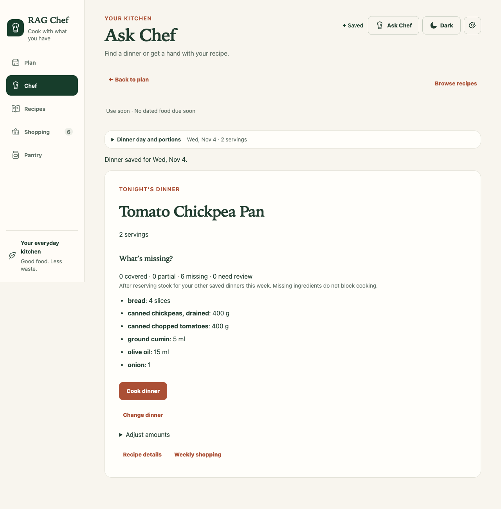
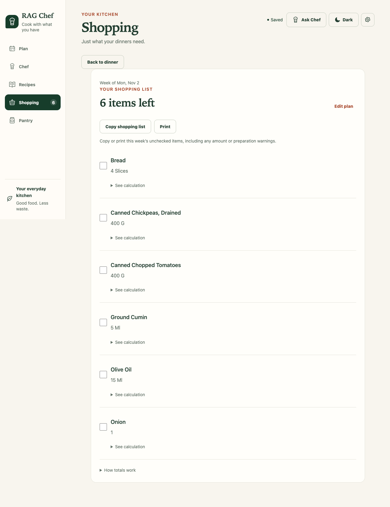
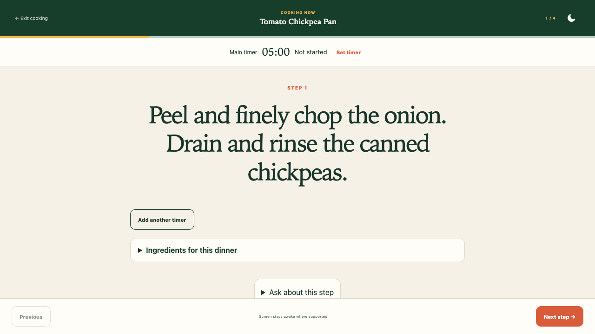
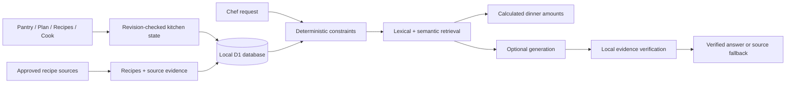

# RAG Chef

[](https://github.com/AvitanMan/rag-chef/actions/workflows/ci.yml)

**Turn what you have into tonight’s dinner—and a shopping list for what you need.**

RAG Chef is a local-first cooking app with a pantry, weekly plan, shopping list,
and step-by-step cooking workspace. Optional AI answers use an approved recipe
catalog, preserve source attribution, and withhold prose that cannot be verified.

Local mode is built for one household on one Mac. Optional
[hosted households](docs/hosted-households.md) add Google sign-in and shared
household access. Browsing, planning, shopping, starter recipes, and calculated
dinner amounts work without an AI model.

## Try it

Requires Node.js 22.13+ and pnpm 11.25.0. The repository pins both versions.

```bash
git clone https://github.com/AvitanMan/rag-chef.git
cd rag-chef
pnpm install --frozen-lockfile
pnpm db:migrate
pnpm dev
```

Open [localhost:3000](http://localhost:3000) and select **Load starter recipes**.
Three original MIT-licensed recipes let you try the complete flow without an
account, model, or recipe download. Your pantry starts empty; adding starters
changes only the catalog. Starter setup runs in the background and shows progress
until the recipes are ready. The larger third-party evaluation corpus is never
loaded as application data.

1. Review allergies, diet, and equipment in **Settings**; add what you have to **Pantry**.
2. Choose a dinner. Review portions and missing ingredients in its dinner panel.
3. Open **Weekly shopping** to review, copy, or print the ingredients still needed.
4. Select **Cook dinner** for directions, independent timers, and source-linked help.
5. Mark the dinner cooked. Pantry deductions are optional, and completion can be undone.

## See the flow

These screenshots use the original starter recipes and an empty demonstration
kitchen, not personal data.

| Choose dinner | Review shopping | Cook step by step |
| --- | --- | --- |
|  |  |  |

## What it does

- **Pantry to dinner:** ingredient search, measured stock coverage, due-soon food,
  favorites, and recently cooked meals.
- **Weekly planning:** dated dinners, portions and amount overrides, copied or
  locked meals, and suggestions that preserve existing plans.
- **Shopping:** combine requirements, reserve stock across dinners, flag unclear
  amounts, and review purchases before adding them to the pantry.
- **Cooking:** original directions, multiple recoverable timers, optional screen
  wake lock, and source-specific questions about the current step.
- **Recovery:** local database persistence, browser drafts, conflict handling,
  undo, and kitchen backups including cooking preferences.

Known allergy, diet, equipment, and ingredient conflicts are filtered before
ranking. Unknown suitability and quantities stay visible for review. These
checks do not certify allergy safety or cross-contact conditions.

## Optional AI

For local generation and semantic search, install and run Ollama, then pull:

```bash
ollama pull qwen3.5:9b
ollama pull nomic-embed-text
```

Use **Settings → Test connection** to check generation, search, and answer
verification separately. Missing embeddings keep lexical/pantry search usable.
OpenAI generation is optional, but verified source answers still require the
local Ollama verifier. The app checks that dependency before paid generation.

[Configuration and model setup](docs/guide.md#enable-local-ai) explains local
environment files, optional server-side keys, and production-style local preview.

## How it works



React/Next.js-compatible app code runs through **Vinext/Vite** and Cloudflare's
local runtime. A private Catalog Worker handles recipe retrieval and queued
imports/indexing. A private Chef Worker handles answers, model requests and
readiness checks. The application Worker owns authentication and kitchen writes.
All three share D1, and Chef accesses kitchens through a read-only application port. **Drizzle** manages D1 migrations. **Ollama** supplies local models;
OpenAI is an optional generation provider. No separate vector database is needed.
Original recipe text, selected evidence, calculated amounts, and suggested
adaptations remain distinct; suggestions never silently rewrite saved meals.

## Evidence and checks

| Check | What it establishes |
| --- | --- |
| Source, SQL, hook, build, and browser tests | Application behavior and recovery contracts |
| Fresh-installation tests | Setup and dinner selection without AI or a preloaded catalog |
| 40 synthetic retrieval/claim cases | Independently gated development and held-out retrieval and verification quality |
| Eight source-answering checks | Answer usefulness, expected uncertainty, and safe withholding reported separately |
| Nine real-model journeys / 24 turns | Recipe follow-ups, constraints, quantities, source scope, and latency |

See the [v0.2.0 evidence summary](docs/release-evidence.md) and
[evaluation methodology](docs/evaluation.md) for exact denominators, model
fingerprints, thresholds, and limitations. Provider-mocked CI is not a measurement
of real-model answer quality. Historical retrieval metrics are not general
answer-accuracy claims.

```bash
pnpm typecheck
pnpm lint
pnpm test
pnpm exec playwright install chromium webkit
pnpm test:e2e
pnpm test:setup
pnpm test:smoke
pnpm test:dev
# After creating the collector's Python environment:
pnpm recipes:test
```

Tests use disposable databases and original synthetic recipes. Personal kitchen
state, configuration, and imported recipe runs are not copied into CI.

## Documentation and boundaries

- [Operating guide](docs/guide.md): kitchen flows, source import, configuration,
  backups, offline behavior, API routes, and troubleshooting.
- [Service boundaries](docs/service-boundaries.md): Kitchen, Catalog and Chef
  interfaces, durable kitchen commands, private Catalog/Chef Workers, background
  jobs, shared model capacity and household request limits.
- [Service rollout and rollback](docs/service-rollout.md): matched releases,
  migration and readiness gates, deployment order and recovery.
- [Evaluation](docs/evaluation.md): real-model commands, grading, and release evidence.
- [Contributing](CONTRIBUTING.md): local verification and review expectations.
- [NOTICE](NOTICE): recipe-source attribution and content licenses.

The [MIT license](LICENSE) covers original application work and starter recipes.
Wikibooks content retains its attribution and CC BY-SA terms; TheMealDB content
has separate terms. Neither the recipe corpus nor your local database becomes
MIT-licensed merely by being used with this application.

Keep standalone mode bound to loopback. Hosted mode requires explicit auth,
database, and source configuration; publishing the code does not deploy a kitchen.
Never commit `.env.local`, `.dev.vars`, `.wrangler/`, kitchen backups, or other
personal local state. See the guide for exact offline and backup limits.
