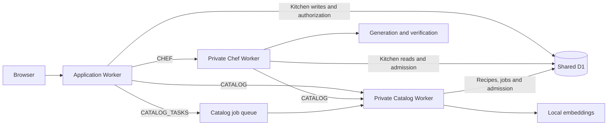

# Application service boundaries

Stages 2 and 3 introduced Kitchen, Catalog and Chef interfaces and durable
Kitchen command retries. Stage 4 moved Catalog reads and background recipe work
to a private Catalog Worker. Stage 5 moves Chef orchestration, model requests and
connection checks to a private Chef Worker. Stage 6 adds shared provider admission,
household request limits, correlated timings and release compatibility checks.
All three Workers use the same D1 database; kitchen transactions remain in the
application Worker. Apply all migrations, including
`0006_kitchen_command_receipts.sql`, `0007_catalog_jobs.sql` and
`0008_runtime_admission.sql` and `0009_catalog_job_recipe_receipts.sql`, before starting
the new runtime. Hosted identity is described in
[hosted households](hosted-households.md).



## Ownership and dependency direction

| Boundary | Owns | Entry point |
| --- | --- | --- |
| HTTP routes | Authentication, bounded request parsing, status codes and response headers | `app/api/**/route.ts` |
| Kitchen | Validated kitchen snapshots and typed edits to pantry, dinners, purchases and preferences | `app/lib/kitchen-service.ts` |
| Catalog reads | Approved source policy, recipe versions and retrieval through the private service binding | `app/lib/catalog-read-service.ts` |
| Catalog jobs | Reviewed imports, starter recipes, source sync and embedding refresh | `app/lib/catalog-job-executor.ts`, `app/lib/catalog-job-runner.ts` |
| Catalog repository | Recipe, source and metadata persistence, with fenced background writes | `app/lib/catalog-service.ts`, `app/lib/recipe-store.ts` |
| Chef | Private Worker context checks, retrieval orchestration, evidence selection, answer validation and fallback | `worker/chef.ts`, `app/lib/chef-service.ts` |
| Model transport | Provider requests, cancellation, response decoding and generation deadlines | `app/lib/chef-provider.ts` |
| Runtime admission | Shared provider capacity and household Chef request windows | `app/lib/runtime-model-admission.ts`, `app/lib/runtime-admission.ts` |
| Repositories | D1 queries, atomic revision checks and authorization at the write boundary | `app/lib/kitchen-store.ts`, `app/lib/recipe-store.ts` |

Routes call application services. Chef receives a read-only Kitchen port, a
read-only Catalog port and a model transport. It cannot save kitchen state or
import recipes. Service factories accept injected ports so their behavior can
be tested without Worker bindings. The default Kitchen instance composes its D1
adapter. Application Catalog reads use the `CATALOG` service binding; the Catalog
Worker composes its local read adapter. Application Chef and readiness routes
forward through `CHEF`; the Chef Worker composes the orchestration ports and uses
its own `CATALOG` binding. Metadata review remains synchronous.

ESLint prevents API routes from importing Kitchen/Catalog stores directly.
Pure calculations, validation and commands remain in `app/lib` and are shared
by the browser and server. The command module cannot import React, authentication,
Node or Cloudflare adapters. These are internal TypeScript interfaces. The private
Worker HTTP contracts separately advertise protocol and controls version 1.

## Kitchen command contract

`applyKitchenCommand(state, command, context)` is a pure reducer. Every command
has a `commandId`, `expectedRevision` and a discriminated `type`. IDs, timestamps,
household dates and permission facts are supplied by callers. The reducer checks
the command preconditions and validates the complete resulting state. Invalid,
stale, protected and unchanged operations return the original state object.

Commands include dinner amounts, locking, placement, completion and undo;
shopping checkmarks, purchase recording and undo; pantry batch additions,
replacement and undo; and preferences. Dinner edits carry the expected meal ID.
Completion additionally checks the dinner fingerprint, and undo checks its
completion receipt. Pantry edits check the original batch snapshot. These guards
keep an old dialog from changing a replacement dinner or overwriting a newer
stocktake.

The browser uses `useKitchen.command` to create an identity before applying an
optimistic edit. Its per-tab browser draft contains an ordered pending-write
queue. Ordinary commands use `POST /api/kitchen/commands`; bulk planning,
backup restoration and explicit recovery use revision-checked
`PUT /api/kitchen` snapshot barriers in the same queue. A snapshot cannot
overtake a pending command. Existing stocktake dialogs, offline drafts and
explicit conflict resolution remain in place.

`KitchenService.execute` validates the command, checks for a prior receipt,
reads the scoped document, checks its revision and reduces the command. The
repository inserts the receipt and changes the kitchen in a single D1 batch
transaction. It rechecks the revision, current household membership, session and
owner-only profile permissions within SQL. A race or failed statement cannot
partially save pantry changes or receipts. The reducer's permission check is
an early guard; the repository remains authoritative. No-op results also have
receipts and require the original revision to still be current.

## Command API and retries

Send a JSON `KitchenCommand` directly to `POST /api/kitchen/commands`, for example:

```json
{
  "commandId": "unique-intent-id",
  "expectedRevision": 12,
  "type": "ReplacePantryBatch",
  "snapshot": { "id": "rice-batch", "name": "rice", "measure": "1 kg" },
  "replacement": { "id": "rice-batch", "name": "rice", "measure": "750 g" }
}
```

The endpoint requires the same origin and household authentication as snapshot
writes. Hosted callers must also send `X-Rag-Chef-Actor` and
`X-Rag-Chef-Household` matching their current session. The server derives identity
from the authenticated context; callers cannot put it in the command payload.
The response is `{ commandId, applied, document, replayed }`, with `Cache-Control:
no-store`. A valid command whose domain preconditions no longer match returns
`applied: false`; it does not partly change the kitchen.

| Status | Meaning |
| --- | --- |
| 200 | Original applied/no-op result, or its durable replay |
| 400 `INVALID_COMMAND` | Invalid JSON, unknown fields/type, invalid values or oversized resulting state |
| 413 `COMMAND_TOO_LARGE` | Body exceeds 2,000,000 bytes, including streamed requests |
| 415 `INVALID_CONTENT_TYPE` | Request is not JSON |
| 409 `REVISION_CONFLICT` | New command uses an outdated revision; response includes `current` |
| 409 `COMMAND_ID_REUSED` | This account already used the ID in this household for a different payload |
| 401/403 | Current authentication, scope or permissions do not allow access |
| 503 | Storage unavailable; retry the identical command |

Receipts are keyed by household, actor and command ID. The SHA-256 request
identity includes every field, including `expectedRevision`; object-key ordering
does not matter, while array order does. A retry returns the **original** document
and `applied` result, even after later edits or a Worker restart, with
`replayed: true`. It does not advance the revision or repeat stock deductions.
That document may be older than the current kitchen; clients must not interpret
it as an instruction to overwrite newer work. Live access is checked on every
lookup; revocation prevents replay. Owner-only profile commands require owner
access even when retrying.

The browser pins an unsent command to the confirmed revision immediately before
its first network attempt, then persists the exact envelope for subsequent
attempts. A lost command response can be recovered after reload by retrying that
envelope. Later unsent intents stay queued. Revision conflicts require the
existing explicit choice of versions; attempted commands are never automatically
rebased. Choosing a version discards the old queue and uses a snapshot write when
keeping the draft. Legacy drafts without queues still use snapshot recovery.
Snapshot writes themselves do not gain command receipts in this stage.
At most 2,000 writes can be pending in a tab. If browser storage is blocked or
full, the app still attempts database saves and retains the exact command in
memory for retries. It reports that the browser backup is unavailable; recovery
after closing or reloading that tab cannot be guaranteed until storage works.

Validation failures, permission failures and revision conflicts do not consume
a command ID. Applied and no-op receipts are retained without automatic expiry;
deleting a household or account removes its receipts. Each receipt contains its
original kitchen document, so ledger storage grows with command activity. A
future retention policy must retain enough identity/result information to avoid
silently executing an old retry again.
Database backups must preserve kitchen state and receipts together. The app's
existing kitchen JSON import/export remains an explicit snapshot operation; it
does not export or replace the server retry ledger.

Pantry, dinner completion, purchase receipts and undo intentionally remain in one
Kitchen aggregate. Splitting their writes across services would require a new
transaction/recovery design.

## Catalog deployment and background work

The application Worker binds `CATALOG` to the private `rag-chef-catalog` Worker
and publishes job IDs through `CATALOG_TASKS` to `rag-chef-catalog-jobs`.
`wrangler.catalog.jsonc` declares the consumer and a recovery cron. Its public
Workers.dev and preview URLs are disabled. Configure all three `DB` bindings to
the same intended D1 database. The checked-in identifiers are placeholders; these
changes do not deploy or provision resources. Local development/build tools load
all three Workers, and `pnpm start` runs their generated Wrangler configurations.

The application gateway authenticates requests before calling the private read
service. Catalog reads have a bounded deadline and return an unavailable error
when that service cannot be reached. The read port exposes list, embedding,
source-policy and retrieval operations; it cannot mutate kitchens or enqueue
imports. Catalog administration and metadata review keep their existing access
checks. Worker runtimes fail closed if the private binding is missing. Only
plain Node tests without the Worker runtime use the injected local adapter.
The private read protocol also checks that its caller and Catalog agree on hosted mode
and the hosted source allowlist; a configuration mismatch fails closed.

`POST /api/admin/catalog/demo`, `POST /api/admin/catalog`, and
`POST /api/admin/recipes/import` validate and durably enqueue work. They return
HTTP **202**, for example:

```json
{
  "ok": true,
  "job": { "id": "job-id", "kind": "demo", "status": "queued" },
  "statusUrl": "/api/admin/catalog/jobs/job-id"
}
```

This example abbreviates the public job record. Poll `statusUrl` to receive the
same envelope with progress and eventual `result` or `error`. Polling does not
execute work. A successful terminal `result` retains the previous operation's
report shape. Reviewed import reports still identify each saved or failed recipe;
a saved recipe with unavailable local embeddings remains saved with embeddings
pending. The starter setup UI and recipe tools wait for this terminal report.
Metadata preview and review endpoints remain synchronous.

Clients send an `Idempotency-Key` for each intended operation and retain it across
lost acceptance responses. The key is scoped to the actor and access mode; using
it again for the same payload returns the existing job, while a different payload
conflicts. A new explicit retry after a terminal failure uses a new key. The UI
stores its pending starter request in scoped tab storage. Job status is available
only to the authenticated submitting operator; hosted catalog changes require a
current platform administrator. Standalone maintenance retains its loopback/token
boundary. No kitchen state or household cooking preferences enter job payloads.

D1 is authoritative for job state. A queue delivery claims a time-limited lease;
claims, heartbeats, completion and failure compare its token and generation.
Every recipe mutation also checks that lease in the same database transaction as
source permissions. An expired worker cannot write after another worker claims
the job. Queue publication failure, retry backoff and expired leases are
recoverable from D1 by the scheduled worker. Retryable failures have at most
three execution attempts. Each attempt has a twelve-minute cancellation budget.

Each job's first recipe write and its receipt commit in one transaction. A retry
reuses that result while checking the live source permission, job lease and saved
recipe version. If another review has changed or removed the recipe, the old job
stops with `CATALOG_JOB_RECIPE_CHANGED`; it cannot overwrite the newer content.
Receipt identity survives worker restarts and is shared by queue and cron retries.
Migration 0009 stops previously attempted unfinished recipe-writing jobs for
operator review because their earlier writes have no receipts; it preserves
their payloads and progress, never-started jobs and pure embedding jobs.

Embedding refreshes process eight recipes at a time and persist each successful
provider batch of at most eight vectors, including individual source-step
vectors. Provider calls have at most a thirty-second timeout. Heartbeats and
cancellation checks occur between batches. A failed or interrupted refresh keeps
already saved vectors; retry skips vectors that still match the source content
and model. Model failure does not remove saved source recipes. Source sync and
embedding refresh report retryable job failures when the provider fails.

Source initialization only inserts an absent approval row. It never restores an
existing source's revoked or restricted permissions. Execution checks current
source policy, and recipe/embedding writes atomically recheck permission, recipe
content/version where applicable, and the job lease. Hosted mode continues to
disable prototype source sync and server embeddings. Hosted reviewed imports
require explicitly enabled source IDs and existing source permissions.

The job table retains submitted review payloads and reports. Back it up together
with recipe-write receipts, sources, versions and embeddings; define an operational retention
policy before long-running production use. Queue messages contain only job IDs.
There is no distributed transaction between recipe work and kitchen edits.

## Chef deployment and request contract

The application Worker binds `CHEF` to `rag-chef-chef`, configured in
`wrangler.chef.jsonc`. This Worker also binds `CATALOG` to the private Catalog
Worker and `DB` to the same database as the application. It has no public
Workers.dev or preview URL. `/api/chef` and `/api/health` remain the browser-facing
routes; the application gateway handles authentication, bounded parsing and
public error responses before forwarding a private request.

The gateway supplies the authenticated household context and internal session ID,
not client-provided household authority, cookies or bearer tokens. Chef validates
live session/membership scope at entry and again before returning an answer.
Kitchen access is through a read-only port, preserving the existing repeated
reads that reject a dinner, active step or stock context changed while an answer
was being prepared. Chef has no kitchen mutation or recipe-import capability in
its application ports. This is a code boundary: the shared D1 binding is not a
separate database with restricted database credentials.

Configure the same hosted mode and source allowlist across the gateway, Chef and
Catalog. Private service requests check policy compatibility rather than silently
using a different source scope. Missing service bindings fail closed in Worker
runtimes. Hosted Chef still produces deterministic/catalog answers and never
uses operator model credentials; moving the worker does not enable hosted AI.

Generation and verification configuration belongs to Chef: `OLLAMA_BASE_URL`,
`OLLAMA_CHAT_MODEL`, `OPENAI_API_KEY`, `OPENAI_BASE_URL`, `OPENAI_MODEL`, and Chef
retrieval/deadline tuning. Catalog needs its own embedding endpoint/model settings
for local semantic retrieval and indexing; it does not need the OpenAI generation
key. Keep non-secret `OLLAMA_EMBED_MODEL` identical on all three Workers: the
gateway still selects the recipe-search model even though it does not call the
provider. Keep embedding endpoints consistent with the readiness checks.
The application gateway does not make model calls. Local development can
share ignored `.env.local`/`.dev.vars` files, but independently deployed Workers
must receive their own intended settings and secrets.

Cancellation propagates from the public request through private service calls and
provider requests, with bounded deadlines retained during response-body reads.
The complete Chef operation has a twenty-minute ceiling, the model connection check has a
fifteen-second ceiling, and individual generation calls retain the existing
configurable limits of 5–300 seconds. Private service calls are not
automatically retried; a lost answer never silently starts another generation.
All Wrangler configurations include `enable_request_signal` alongside
`nodejs_compat`; Vite inherits the gateway flags from its Wrangler config without
duplicating them. Retain that flag while using
the checked-in compatibility date. Chef generation is not queued as background
work. Model connection checks run in Chef so the
Settings connection test observes the runtime that actually holds model settings.

Keep all three `DB` bindings consistent, apply migrations once to that database,
and deploy the private services with the matching application gateway. Stage 6
requires additive runtime admission and recipe-write receipt migrations through
`0009_catalog_job_recipe_receipts.sql`. The worker
configuration files use placeholders and are not a production deployment record.

## Capacity, usage and diagnostics

Every actual generation, verification or embedding operation acquires a durable
D1 permit before contacting its provider. Chef and Catalog share one pool per
provider across Worker isolates and background jobs. Defaults are two concurrent
Ollama operations and four OpenAI operations, configured with
`MODEL_OLLAMA_CONCURRENCY` and `MODEL_OPENAI_CONCURRENCY`. The permit covers the
entire response body and parsing, not just receipt of headers. Embedding batches
release their permit before saving vectors. Pure service factories accept an
injected admission port; deployed Worker compositions supply the D1 adapter.

The complete admitted callback is bounded to at most 300 seconds, including
capacity acquisition. Its permit expires after 360 seconds if a Worker dies.
Cancellation reaches the actual provider/body operation; a permit is released
after that operation ends. A failed release leaves capacity reserved until expiry
and does not turn a successful answer into a repeated paid request. Short model
connection probes and deployment readiness do not consume provider permits.
Hosted mode rejects model use before permit acquisition.

Valid Chef answer requests also consume a household request allowance before
orchestration. Hosted defaults are 60 requests per minute and 1,000 per day;
standalone windows are disabled unless configured. These are fixed UTC windows
and count admitted requests, including deterministic answers and requests whose
later processing fails. They are not token metering or billing limits. The
`CHEF_HOSTED_REQUESTS_PER_MINUTE` / `DAY` and
`CHEF_LOCAL_REQUESTS_PER_MINUTE` / `DAY` settings control those windows. Empty
local values disable a window; zero and malformed values fail closed. Both windows
are checked atomically, so rejection does not consume the other allowance.

Capacity rejection returns `429 service_busy`, and exhausted household allowance
returns `429 usage_limit_exceeded`, with `Retry-After`. Invalid policy or unavailable
model-capacity storage fails closed with `503 runtime_policy_invalid`. These errors
cannot silently enter a model or lexical fallback. Catalog jobs may retry busy
capacity after the indicated delay within their existing three-attempt limit;
completed vector batches remain saved. Interactive Chef calls are never
automatically replayed.

The gateway creates an `X-Request-Id` and propagates it across private calls.
Background execution attaches its durable job ID. Structured service events
record allowlisted operation names, statuses, durations, provider names and Chef
stage timings. They exclude prompts, recipe bodies, kitchen contents, account and
household identifiers, cookies and keys. Request IDs correlate logs; they are
not authorization or idempotency keys.

## Release compatibility

`service-contracts.json` records protocol 1, controls 1 and schema 9. Private
requests advertise required controls and responses advertise protocol/controls;
callers reject incompatible responses. Missing private bindings fail closed.
Catalog accepts an omitted request version for older clients but rejects an
explicit unsupported version. Compatibility headers do not prevent old Worker
code from doing work before its incompatible response is rejected.

The protected `GET /api/admin/services` checks the gateway and both private
Workers without provider calls. It verifies required schema columns and bindings,
then compares hosted/source policy, admission limits, protocol/controls and
`SERVICE_RELEASE`. It returns 200 only when all checks agree; otherwise 503.
Standalone access follows the catalog loopback/admin-token policy; hosted access
requires a current platform administrator. This deployment check is distinct from
the Settings model connection test at `/api/health`.

Run `pnpm services:check` against source configuration and
`pnpm services:check:build` after building. These offline checks do not inspect a
deployed database or prove live readiness. Follow the
[service rollout and rollback runbook](service-rollout.md): private services first,
gateway last, and readiness before traffic. A mixed old/new release cannot
guarantee the new controls.

## Preserved behavior and current limits

- Hosted Chef continues deterministic/catalog fallback without invoking a model.
  Local model behavior and source-grounding policy remain available.
- Chef generation deadlines remain active through response-body consumption,
  including unsuccessful provider responses.
- Catalog ranking still reads up to 1,000 recipes. The service split does not add
  indexed retrieval, a vector database or public catalog access.
- Kitchen, command receipts and catalog jobs share D1. This is a deployment split
  with explicit ports, not separate ownership of database transactions.
- Chef reads the shared kitchen database to preserve live authorization and
  staleness checks. Separate databases would need a new authoritative read and
  transaction design; the Worker split does not provide database isolation.

## Verification

`tests/application-services.test.mjs` exercises injected service ports, Kitchen
compare-and-swap races, hosted profile restrictions, Chef's hosted/no-model and
stale-context paths, lexical constraints, and a stalled provider response body.
`tests/kitchen-commands.test.mjs` covers stale revisions and dinner IDs, protected
meals, deterministic replay, receipt undo and atomic pantry validation. The
existing source, SQL and browser suites continue to exercise the real adapters
and UI, including a stale Plan dialog after another tab replaces the dinner.
Command persistence tests execute the actual migration and SQL, including
duplicate races, rollback, access revocation and replay after later changes.
Browser and hook tests cover lost responses, reload and ordered snapshot recovery.
Catalog tests cover enqueue-only HTTP handlers, retry identities, durable leases,
stale-worker rejection, source-policy changes and partial embedding persistence.
Admission tests cover atomic cross-isolate capacity, household window races,
permits held through streamed bodies, abort/deadline release, hosted zero model
I/O and fail-closed provider boundaries.
The disposable runtime checks run all three Workers and exercise the private
Catalog binding/queue, Chef forwarding, readiness and hosted restrictions.

Run `pnpm typecheck`, `pnpm lint`, `pnpm test`, `pnpm test:e2e`,
`pnpm test:hosted`, `pnpm test:hosted-dev` and `pnpm test:smoke`. These checks
validate application contracts and mocked provider behavior; they do not measure
real-model answer quality or exercise live Google OAuth credentials.
